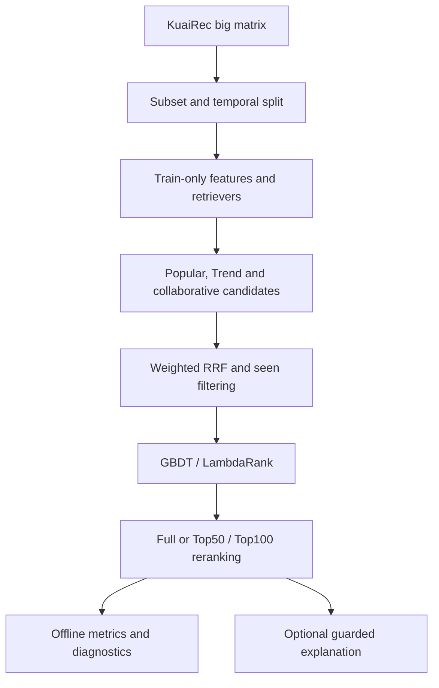
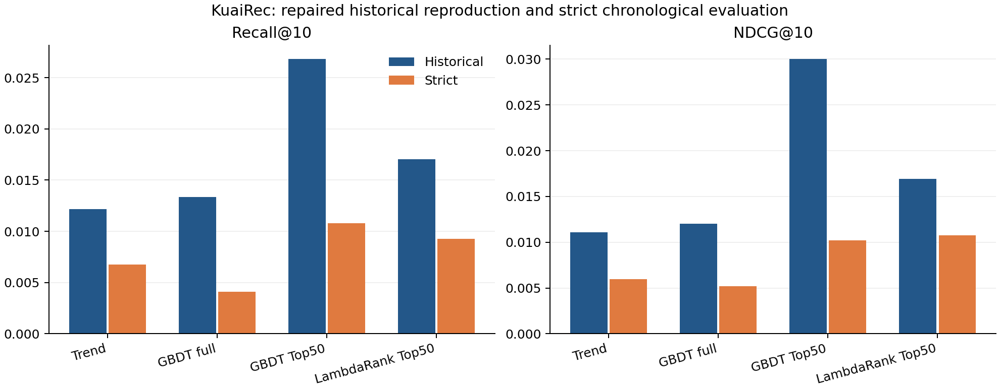

# LLM4Rec

An auditable, multi-stage short-video recommender on **real KuaiRec data**. It combines retrieval, weighted reciprocal-rank fusion, candidate-level ranking, head reranking and offline diagnostics. LLMs may explain selected results; local models choose every item ID.

The repaired reproduction uses **1,000 users, 7,483 videos and 300,000 interactions**. Both the original per-user temporal protocol and a stricter global chronological protocol are recorded. The strict protocol is the primary quality estimate. This is a CPU-scale offline engineering project, with explicit verification boundaries.



## Quick start

Python 3.11 and 3.12 installations, tests and fixture pipelines are verified. No API key, GPU or semantic model download is needed.

```bash
python3.11 -m venv .venv
source .venv/bin/activate
python -m pip install torch==2.6.0 --index-url https://download.pytorch.org/whl/cpu
python -m pip install -r requirements.txt
python -m pip install -e . --no-deps
export OMP_NUM_THREADS=2 OPENBLAS_NUM_THREADS=2 PYTHONHASHSEED=42 HF_HUB_OFFLINE=1
python -m unittest discover -s tests
make smoke-movielens
```

The smoke target uses an **authored MovieLens-format fixture**. It trains all retrieval families and the EmbeddingMLP, DeepFM and DIN rankers, then runs evaluation and candidate diagnostics. Fixture metrics are not real-data results.

## Real-data reproduction

```bash
python scripts/download_kuairec.py
python scripts/reproduce_kuairec.py --protocol strict
python scripts/reproduce_kuairec.py --protocol historical
python scripts/demo_recommend.py  # optionally pass --user-id 1028
```

The downloader verifies the official archive checksum. Missing real inputs fail rather than silently substituting examples. The reproduction fixes seed 42, a 1,500-item Trend pool, two-day decay, train-internal temporal ranker targets, and train/val model fitting. Test labels are used only after both tree models are fitted. Full commands, data provenance, metrics and hashes are tracked under [`reports/reproduction`](reports/reproduction).

See [reproduction instructions](docs/REPRODUCE.md) for clean-environment commands, outputs and metric definitions; [data sources](docs/DATA_SOURCES.md) for sampling, fields, licensing and citation.

## Measured results

Strict chronological test, 928 eligible users; Recall/NDCG/MRR are user-macro averages:

| Experiment | Recall@10 | NDCG@10 | MRR@10 | Recall@100 |
|---|---:|---:|---:|---:|
| Trend retrieval | 0.006745 | 0.005966 | 0.010812 | 0.094395 |
| GBDT full | 0.004093 | 0.005172 | 0.015532 | 0.087349 |
| GBDT Top50 | 0.010793 | 0.010182 | 0.021441 | 0.094395 |
| GBDT Top100 | 0.008848 | 0.010896 | 0.030040 | 0.094395 |
| LambdaRank Top50 | 0.009253 | 0.010768 | 0.026188 | 0.094395 |

GBDT Top50 increases Recall@10 by 60.0% and NDCG@10 by 70.7% against the same retrieval pool. Trend candidate positive recall is 63.73%; 33.51% of eligible test positives have no positive training interaction, and none of these cold positives enter this pool. Head ordering helps; cold-item retrieval remains a separate bottleneck.



Full metrics and historical differences are in the [reproduction report](reports/reproduction/REPRODUCTION_REPORT.md). All ranking experiments share the same candidate pool and eligibility policy within a protocol. Head reranking preserves Recall@100 by construction. Historical improvement percentages are retained as reference observations and are not treated as current verified claims.

## Models and scope

| Stage | Implementations | Verification evidence |
|---|---|---|
| Statistical / collaborative retrieval | Popular, Trend, ItemCF, ExposureQuality, Metadata | Real-data metrics and saved-artifact checks |
| Neural retrieval | BPR-MF, TwoTower, LightGCN, SASRec | Fixed short-training verification; see module status |
| Content retrieval | TF-IDF; optional SentenceTransformer / FAISS | TF-IDF verified; semantic backend requires optional packages |
| Fusion | RRF and weighted RRF | Real-data candidate and ranking comparisons |
| Tree ranking | HistGradientBoosting, LightGBM LambdaRank | Real train/val fitting; full, Top50 and Top100 test evaluation |
| Neural ranking | EmbeddingMLP, DeepFM, DIN | Fixture training and inference; not a real-data quality claim |
| Business reranking | Diversity and tail preference | Deterministic tests; separate from primary experiments |
| Explanation | Template fallback and optional LLM guard | Offline guard tests; live API integration unverified |

For precise per-module labels, read [project status](docs/PROJECT_STATUS.md). The [repair log](docs/REPAIR_AND_REPRODUCTION_LOG.md) documents bugs, methodology changes and remaining limitations.

## Evaluation and limitations

Recall, NDCG, MRR and MAP are computed against independent eligible test positives, including positives absent from candidates. Candidate positive recall is recorded before injection. Injected positives are excluded from tree fitting and predictions; candidate-pool-size features cannot depend on injected labels. Test cannot be selected as a training or validation split.

Seen filtering removes **positive** train+val history, not all prior low-watch exposures. Unexposed candidates are not known dislikes. The global protocol eliminates cross-user future interaction leakage at the split boundaries; the per-user comparison does not. The catalog is transductive and assumed known: publication-time availability is not modeled. The subset contains highly active users and is exposure-biased. Results are single-seed offline measurements, without online A/B tests or significance claims.

The raw adapter uses encrypted categories and placeholder titles, with absent authors/durations. The TF-IDF path is therefore a content-schema baseline rather than a validated video-semantic model. LLM checks reject detectable out-of-candidate IDs; they do not establish complete factual safety of arbitrary generated explanations.

## Repository

```text
configs/       Frozen reproduction and legacy experiment settings
llm4rec/       Dataset adapters, features, retrieval, ranking and evaluation
scripts/       Download, reproduce, diagnose, demo and upload entry points
tests/         Unit and regression checks
examples/      Explicitly labeled tiny fixtures
reports/       Current evidence plus separately labeled historical records
docs/          Reproduction, audit, status and data attribution
```

Raw data, features, weights, caches and credentials are ignored. Small reports and logs are tracked. CI runs compilation, unit tests and the full fixture smoke target on Python 3.11/3.12. Actual remote CI status is recorded in `docs/PROJECT_STATUS.md`; a configured workflow is not proof of a remote passing run.

The source archive did not provide a project-code license, so this delivery does not invent one. KuaiRec data retains its separate upstream license. Public release requires owner approval. `scripts/upload_private.sh` can create a new private repository using an authenticated GitHub CLI; it stops if a repository or origin already exists.
